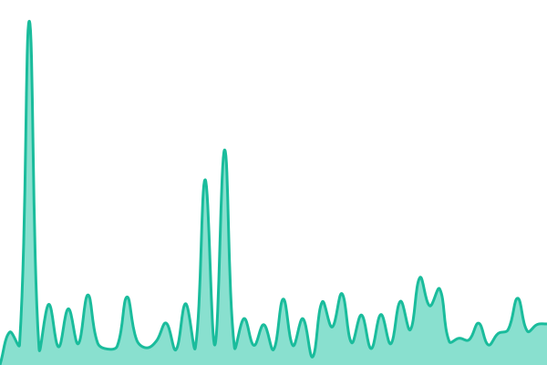
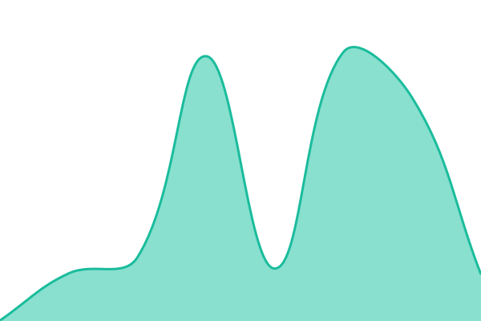

# [📈 Mightora Service Status](https://status.mightora.io/): <!--live status--> **🟧 Partial outage**

This repository contains the open-source uptime monitor and status page for [mightora](https://mightora.io/), powered by [Upptime](https://github.com/upptime/upptime).

With [Upptime](https://upptime.js.org), you can get your own unlimited and free uptime monitor and status page, powered entirely by a GitHub repository. We use [Issues](https://github.com/mightora/status/issues) as incident reports, [Actions](https://github.com/mightora/status/actions) as uptime monitors, and [Mightora Service Status](https://status.mightora.io/) for the status page.

<!--start: status pages-->
<!-- This summary is generated by Upptime (https://github.com/upptime/upptime) -->
<!-- Do not edit this manually, your changes will be overwritten -->
<!-- prettier-ignore -->
| URL | Status | History | Response Time | Uptime |
| --- | ------ | ------- | ------------- | ------ |
|  [TechTweedie Blog](https://techtweedie.github.io) | 🟩 Up | [tech-tweedie-blog.yml](https://github.com/mightora/status/commits/HEAD/history/tech-tweedie-blog.yml) | 

 229ms
     
 | 

<a href="https://status.mightora.io/history/tech-tweedie-blog">100.00%</a>
    

|  [Mightora | Home Page](https://mightora.io) | 🟩 Up | [mightora-home-page.yml](https://github.com/mightora/status/commits/HEAD/history/mightora-home-page.yml) | 

 197ms
     
 | 

<a href="https://status.mightora.io/history/mightora-home-page">100.00%</a>
    

|  [Mightora | Feedback](https://feedback.mightora.io) | 🟩 Up | [mightora-feedback.yml](https://github.com/mightora/status/commits/HEAD/history/mightora-feedback.yml) | 

 200ms
     
 | 

<a href="https://status.mightora.io/history/mightora-feedback">100.00%</a>
    

|  [Mightora | Presentation Slides](https://slides.mightora.io) | 🟩 Up | [mightora-presentation-slides.yml](https://github.com/mightora/status/commits/HEAD/history/mightora-presentation-slides.yml) | 

 538ms
     
 | 

<a href="https://status.mightora.io/history/mightora-presentation-slides">100.00%</a>
    

|  [Mightora | WiFi Captive Portal Helper - Connect](http://connect.mightora.io/) | 🟩 Up | [mightora-wi-fi-captive-portal-helper-connect.yml](https://github.com/mightora/status/commits/HEAD/history/mightora-wi-fi-captive-portal-helper-connect.yml) | 

 398ms
     
 | 

<a href="https://status.mightora.io/history/mightora-wi-fi-captive-portal-helper-connect">100.00%</a>
    

|  [Mightora | WiFi Captive Portal Helper - Connecting](https://connecting.mightora.io) | 🟥 Down | [mightora-wi-fi-captive-portal-helper-connecting.yml](https://github.com/mightora/status/commits/HEAD/history/mightora-wi-fi-captive-portal-helper-connecting.yml) | 

 0ms
     
 | 

<a href="https://status.mightora.io/history/mightora-wi-fi-captive-portal-helper-connecting">0.00%</a>
    

|  [Mightora | WiFi Captive Portal Helper - Connected](https://connected.mightora.io) | 🟥 Down | [mightora-wi-fi-captive-portal-helper-connected.yml](https://github.com/mightora/status/commits/HEAD/history/mightora-wi-fi-captive-portal-helper-connected.yml) | 

 0ms
     
 | 

<a href="https://status.mightora.io/history/mightora-wi-fi-captive-portal-helper-connected">0.00%</a>
    

|  [Mightora | API](https://api.mightora.io) | 🟥 Down | [mightora-api.yml](https://github.com/mightora/status/commits/HEAD/history/mightora-api.yml) | 

 436ms
     
 | 

<a href="https://status.mightora.io/history/mightora-api">0.00%</a>
    

|  [Mightora | QR Code Generator](https://qr.mightora.io/) | 🟩 Up | [mightora-qr-code-generator.yml](https://github.com/mightora/status/commits/HEAD/history/mightora-qr-code-generator.yml) | 

 161ms
     
 | 

<a href="https://status.mightora.io/history/mightora-qr-code-generator">100.00%</a>
    

|  [Mightora | Radar - For generating technology radars](https://radar.mightora.io) | 🟩 Up | [mightora-radar-for-generating-technology-radars.yml](https://github.com/mightora/status/commits/HEAD/history/mightora-radar-for-generating-technology-radars.yml) | 

 175ms
     
 | 

<a href="https://status.mightora.io/history/mightora-radar-for-generating-technology-radars">100.00%</a>
    

|  [Mightora | Roadmaps](https://roadmaps.mightora.io/) | 🟩 Up | [mightora-roadmaps.yml](https://github.com/mightora/status/commits/HEAD/history/mightora-roadmaps.yml) | 

 190ms
     
 | 

<a href="https://status.mightora.io/history/mightora-roadmaps">100.00%</a>
    

|  [Mightora | Custom Connector Builder](https://custom-connector-builder.mightora.io/) | 🟩 Up | [mightora-custom-connector-builder.yml](https://github.com/mightora/status/commits/HEAD/history/mightora-custom-connector-builder.yml) | 

 141ms
     
 | 

<a href="https://status.mightora.io/history/mightora-custom-connector-builder">100.00%</a>
    

|  [Mightora | JSON Explorer](https://json-explorer.mightora.io/) | 🟩 Up | [mightora-json-explorer.yml](https://github.com/mightora/status/commits/HEAD/history/mightora-json-explorer.yml) | 

 200ms
     
 | 

<a href="https://status.mightora.io/history/mightora-json-explorer">100.00%</a>
    

|  [Ian Tweedie | Personal Website](https://iantweedie.biz) | 🟩 Up | [ian-tweedie-personal-website.yml](https://github.com/mightora/status/commits/HEAD/history/ian-tweedie-personal-website.yml) | 

 936ms
     
 | 

<a href="https://status.mightora.io/history/ian-tweedie-personal-website">100.00%</a>
    

|  [Ian Tweedie | Presentation Archive](https://itweedie.github.io) | 🟩 Up | [ian-tweedie-presentation-archive.yml](https://github.com/mightora/status/commits/HEAD/history/ian-tweedie-presentation-archive.yml) | 

 137ms
     
 | 

<a href="https://status.mightora.io/history/ian-tweedie-presentation-archive">100.00%</a>
    

|  [Power Platform Clinic](https://powerplatformclinic.github.io) | 🟩 Up | [power-platform-clinic.yml](https://github.com/mightora/status/commits/HEAD/history/power-platform-clinic.yml) | 

 131ms
     
 | 

<a href="https://status.mightora.io/history/power-platform-clinic">100.00%</a>
    

|  [Tweed Technology Limited](https://tweed.technology) | 🟩 Up | [tweed-technology-limited.yml](https://github.com/mightora/status/commits/HEAD/history/tweed-technology-limited.yml) | 

 246ms
     
 | 

<a href="https://status.mightora.io/history/tweed-technology-limited">100.00%</a>
    

|  [Hero Academy | Reading](https://reading.heroacademy.app/) | 🟩 Up | [hero-academy-reading.yml](https://github.com/mightora/status/commits/HEAD/history/hero-academy-reading.yml) | 

 192ms
     
 | 

<a href="https://status.mightora.io/history/hero-academy-reading">100.00%</a>
    

|  [Mightora | Architecture Lab](https://architecture-lab.mightora.io/) | 🟩 Up | [mightora-architecture-lab.yml](https://github.com/mightora/status/commits/HEAD/history/mightora-architecture-lab.yml) | 

 163ms
     
 | 

<a href="https://status.mightora.io/history/mightora-architecture-lab">100.00%</a>
    

|  [Mightora | Code Diff](https://code-diff.mightora.io/) | 🟩 Up | [mightora-code-diff.yml](https://github.com/mightora/status/commits/HEAD/history/mightora-code-diff.yml) | 

 248ms
     
 | 

<a href="https://status.mightora.io/history/mightora-code-diff">100.00%</a>
    

|  [Mightora | Power BI Diff](https://power-bi-diff.mightora.io/) | 🟩 Up | [mightora-power-bi-diff.yml](https://github.com/mightora/status/commits/HEAD/history/mightora-power-bi-diff.yml) | 

 160ms
     
 | 

<a href="https://status.mightora.io/history/mightora-power-bi-diff">100.00%</a>
    

|  [Mightora | Semantic Model](https://semantic-model.mightora.io/) | 🟩 Up | [mightora-semantic-model.yml](https://github.com/mightora/status/commits/HEAD/history/mightora-semantic-model.yml) | 

 158ms
     
 | 

<a href="https://status.mightora.io/history/mightora-semantic-model">100.00%</a>
    

|  [Mightora | Power BI Inspector](https://powerbi-inspector.mightora.io/) | 🟩 Up | [mightora-power-bi-inspector.yml](https://github.com/mightora/status/commits/HEAD/history/mightora-power-bi-inspector.yml) | 

 129ms
     
 | 

<a href="https://status.mightora.io/history/mightora-power-bi-inspector">100.00%</a>
    

|  [Mightora | DAX](https://dax.mightora.io/) | 🟩 Up | [mightora-dax.yml](https://github.com/mightora/status/commits/HEAD/history/mightora-dax.yml) | 

 203ms
     
 | 

<a href="https://status.mightora.io/history/mightora-dax">100.00%</a>
    

|  [Mightora | Solution Explorer](https://solution-explorer.mightora.io/) | 🟩 Up | [mightora-solution-explorer.yml](https://github.com/mightora/status/commits/HEAD/history/mightora-solution-explorer.yml) | 

 159ms
     
 | 

<a href="https://status.mightora.io/history/mightora-solution-explorer">100.00%</a>
    

|  [Mightora | REST Builder](https://rest.mightora.io/) | 🟩 Up | [mightora-rest-builder.yml](https://github.com/mightora/status/commits/HEAD/history/mightora-rest-builder.yml) | 

 238ms
     
 | 

<a href="https://status.mightora.io/history/mightora-rest-builder">100.00%</a>
    

|  [Mightora | FetchFlow](https://fetchflow.mightora.io/) | 🟩 Up | [mightora-fetch-flow.yml](https://github.com/mightora/status/commits/HEAD/history/mightora-fetch-flow.yml) | 

 258ms
     
 | 

<a href="https://status.mightora.io/history/mightora-fetch-flow">100.00%</a>
    

|  [Mightora | Expression Lab](https://expression-lab.mightora.io/) | 🟩 Up | [mightora-expression-lab.yml](https://github.com/mightora/status/commits/HEAD/history/mightora-expression-lab.yml) | 

 167ms
     
 | 

<a href="https://status.mightora.io/history/mightora-expression-lab">100.00%</a>
    

|  [Mightora | HAR Analyzer](https://har.mightora.io/) | 🟩 Up | [mightora-har-analyzer.yml](https://github.com/mightora/status/commits/HEAD/history/mightora-har-analyzer.yml) | 

 161ms
     
 | 

<a href="https://status.mightora.io/history/mightora-har-analyzer">100.00%</a>
    

|  [Mightora | Slides Beta](https://beta.slides.mightora.io/) | 🟩 Up | [mightora-slides-beta.yml](https://github.com/mightora/status/commits/HEAD/history/mightora-slides-beta.yml) | 

 403ms
     
 | 

<a href="https://status.mightora.io/history/mightora-slides-beta">100.00%</a>
    

|  Test B | 🟥 Down | [test-b.yml](https://github.com/mightora/status/commits/HEAD/history/test-b.yml) | 

 0ms
     
 | 

<a href="https://status.mightora.io/history/test-b">0.00%</a>
    

<!--end: status pages-->

[**Visit our status website →**](https://status.mightora.io/)

## 📄 License

- Powered by: [Upptime](https://github.com/upptime/upptime)
- Code: [MIT](./LICENSE) © [Anand Chowdhary](https://anandchowdhary.com)
- Data in the `./history` directory: [Open Database License](https://opendatacommons.org/licenses/odbl/1-0/)
